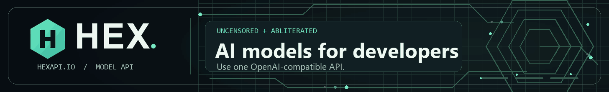

  

  <h1>HEX API</h1>
  
Uncensored and abliterated AI models for developers. Try a model in your browser, then use the same model ID in your app or in OpenCode Desktop.

  
  
  
   
  
  
  

## Find your starting point

| I want to… | Start here |
| --- | --- |
| Browse uncensored and abliterated models by family | [HEX Model Catalog](https://github.com/hexapi-io/hex-model-catalog) |
| Make my first request with curl, Python, or Node.js | [HEX API Quickstart](https://github.com/hexapi-io/hex-api-quickstart) |
| Work on a local project in OpenCode Desktop | [OpenCode Desktop setup](https://github.com/hexapi-io/hex-opencode-setup) |

## Featured model guides

- **[GLM 5.3 Abliterated](https://github.com/hexapi-io/glm-5.3-abliterated)** · Turn a bug report into a structured engineering ticket with Python.
- **[DeepSeek V4 Pro Uncensored](https://github.com/hexapi-io/deepseek-v4-pro-uncensored)** · Stream a release checklist into your terminal with Node.js.

[Service status](https://hexapi.io/status) · [Support](https://hexapi.io/support)
